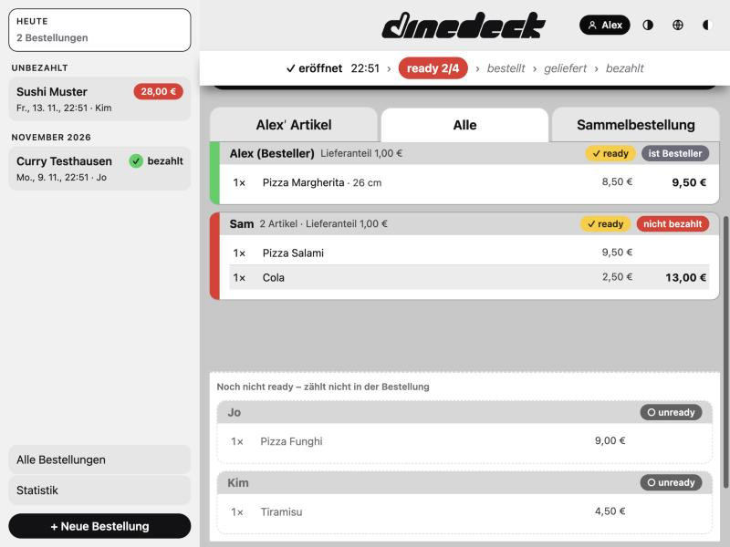
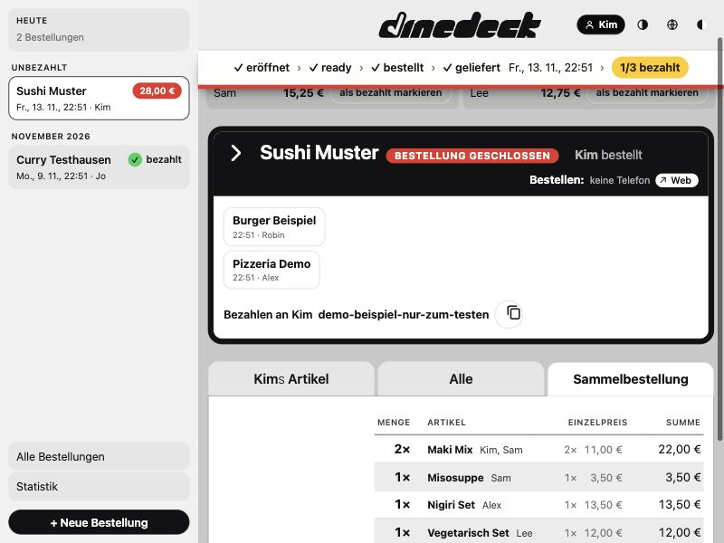
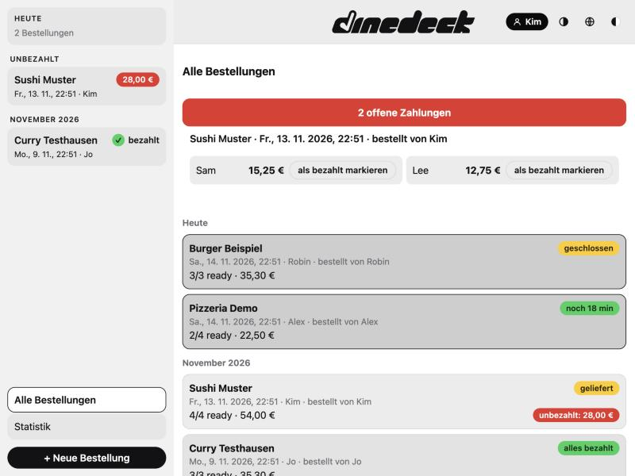

# dinedeck

Group food ordering. One person opens an **order** at a restaurant, everyone adds items and marks themselves **ready**, later **paid**. Everyone sees the same state live.

Vanilla JS, no build step, no dependencies. Node ≥ 22.13 (`node:sqlite`), live updates via SSE.

## Features

- **Items:** article, variant, price, quantity. Own rows are editable until ready; deleting offers a 15 s undo. Items are grouped by name + variant + price, ignoring case, spacing, punctuation and umlaut spelling.
- **Catalog per restaurant:** names and variants from earlier orders are suggested. Prices are never prefilled; the last price is offered as an unchecked chip. Price deviations are flagged.
- **Tabs:** own items, everyone (one card per user), combined order (for phoning or copying, with menu link).
- **Status line:** `opened › ready › ordered › delivered › paid` with times; the latest step is highlighted. Banners for users not yet ready and for open amounts.
- **Ready and paid** are independent per-user flags. Any change to your items resets your ready flag. Only the user or the buyer can set paid. Ready is yellow, unready red, paid green.
- **Deadline** (default 20 min, `+5 min`). When it expires or an admin/creator/buyer closes the order, items of unready users stay visible but do not count. Optional auto-close once everyone is ready; new users then need approval.
- **Locked from "ordered":** no item or user changes, deadline and buyer data frozen; "take back ordered" reopens.
- **Buyer and payment:** buyer, PayPal address and delivery fee (split equally among users with items). PayPal address (per buyer) and fee (per restaurant) are remembered. The pay block offers a link with the user's amount and a QR code of it. The address is visible only to participants, buyer, creator and admins.
- **Navigation:** sidebar (open / unpaid / closed, live) from 700 px, list on the start page on phones. Each order has its own URL (`#/r/<id>`). Orders from today show only the time.
- **Statistics:** top restaurant, favourite dish per restaurant, average item price and order total. No per-user statistics. Admins can export all item rows as JSON.
- **Appearance:** light/dark/auto, colour themes, German/English.

## Run

```sh
npm start                  # http://127.0.0.1:3000
ADMINS=anna,ben npm start  # admins can manage every order
npm test
```

| Variable  | Default               | Meaning                   |
|-----------|-----------------------|---------------------------|
| `HOST`    | `127.0.0.1`           | Bind address              |
| `PORT`    | `3000`                | Port                      |
| `DB_FILE` | `./data/dinedeck.db`  | SQLite file               |
| `ADMINS`  | empty                 | Comma-separated usernames |
| `FRAME_ANCESTORS` | empty | Space/comma-separated origins (e.g. `https://l.example.org`) allowed to embed the app in an iframe; `any` = every site; empty = embedding blocked |

Backup while running: `sqlite3 data/dinedeck.db ".backup backup.db"`.

## Demo

`npm run demo` fills an empty database (`./data/demo.db`, or `DB_FILE`) with four invented orders and invented names (Alex, Sam, Jo, Kim, Robin, Lee). A database that already has orders is never touched. Try it: `DB_FILE=data/demo.db npm start`, then enter one of the names. With Docker Compose, `DEMO=1 docker compose up -d --build` seeds the empty volume on start.

| Open order | Delivered, partly paid |
|---|---|
|  |  |
| **Combined order** | **All orders** |
|  |  |

## Hosting with Docker Compose

```sh
git clone https://github.com/01msmr/dinedeck && cd dinedeck
echo 'ADMINS=anna,ben' > .env         # optional settings, see below
docker compose up -d --build           # builds the image, starts it in the background
```

- **Settings:** `compose.yaml` reads `ADMINS` and `FRAME_ANCESTORS` from the shell or from a `.env` file next to it (`ADMINS=anna,ben`). `HOST`, `PORT` and `DB_FILE` are set in the image (`0.0.0.0`, `3000`, `/data/dinedeck.db`).
- **Port:** The default publishes `127.0.0.1:3000` only. For a local network change it to `"3000:3000"`. For the internet put a reverse proxy with HTTPS in front and keep the default.
- **HTTPS:** The browser only copies to the clipboard (copy buttons) and an embedding site only accepts an iframe over HTTPS. Example with Caddy: `dinedeck.example.org { reverse_proxy 127.0.0.1:3000 }`. Live updates use server-sent events; the proxy must not buffer them (Caddy does not, with nginx set `proxy_buffering off` for `/api/events`).
- **Data:** The SQLite file lives in the named volume `dinedeck-data` and survives rebuilds. There is no login, see Security below.
- **Update:** `git pull && docker compose up -d --build`. New source files must be added to the `COPY` lines in the `Dockerfile`.
- **Logs and stop:** `docker compose logs -f`, `docker compose down` (the volume stays; `down -v` deletes the data).
- **Backup:** Stop the container, copy the file out, start it again:
  ```sh
  docker compose stop
  docker run --rm -v dinedeck-data:/data -v "$PWD":/backup alpine cp /data/dinedeck.db /backup/
  docker compose start
  ```
- **Restore or import** an existing database (same steps, other direction, container stopped):
  ```sh
  docker compose stop
  docker run --rm -v dinedeck-data:/data -v "$PWD":/backup alpine sh -c 'rm -f /data/dinedeck.db-* && cp /backup/dinedeck.db /data/dinedeck.db && chown 1000:1000 /data/dinedeck.db'
  docker compose start
  ```
  The `rm` removes old `-wal`/`-shm` files that could overlay the imported file, the `chown` gives the file to the image's `node` user (uid 1000).

## Structure

```
server.js            HTTP server, routes, SSE, static files
security.js          Security headers (CSP, nosniff, referrer policy, frame denial)
db.js                Business logic: writes, permissions, validation
db/                  schema.js, queries.js, read.js (reads, stats, export), helpers.js, errors.js
public/config.js     All tunable values (limits, defaults, lists, timings), shared by server and client
public/format.js     Pure helpers (times, payHref, round stage), unit-tested
public/qr.js         QR encoder (byte mode, ECC M, up to 106 bytes)
public/app.js        Entry: name prompt, router, live updates
public/views/        home, all, stats, round; round/ holds status, users, order, pay, qr-icon
public/i18n.js       Translations (German text is the key)
public/style.css     Colours via light-dark(), lengths in rem (1rem = 16 px)
test/                api, format, group, qr  (npm test)
```

Notes:

- The code still calls an order a **round** (`rounds` table, `/api/rounds`); the UI says "order".
- New UI text: use `t('German text')` and add the English entry to `public/i18n.js`.
- Limits appear as text in server errors in `db.js`; update them together with `config.js` and `i18n.js`.
- Amounts in the UI go through `money()` (decimal mark per language).

## Security

All responses carry security headers; static files are served with `Cache-Control: no-cache` and `index.html` adds a cache-busting `?v=`.

There is deliberately **no login**: the username comes from the browser and is trusted, so hiding the PayPal address is only a visibility rule. Intended for trusted networks (local, office, home). Do not expose it to the internet unprotected.
