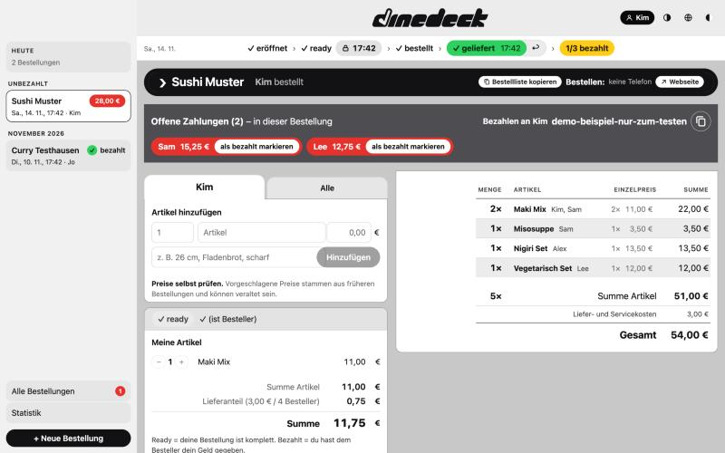
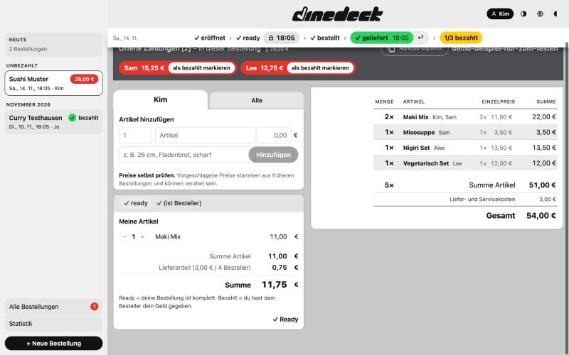
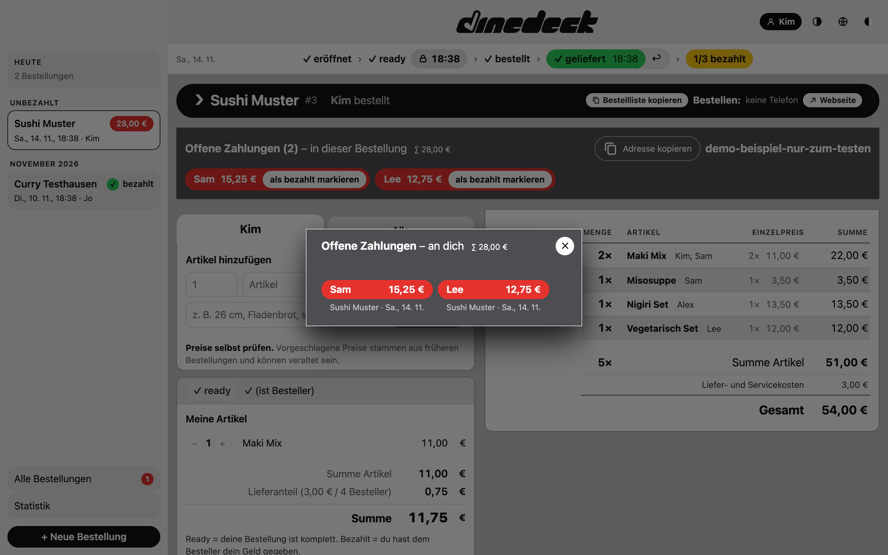

# dinedeck

Group food ordering. One person opens an **order** at a restaurant, everyone adds items and marks themselves **ready**, later **paid**. Everyone sees the same state live.

Vanilla JS, no build step, no dependencies. Node ≥ 22.13 (`node:sqlite`), live updates via SSE.

## Features

- **Items:** article, variant, price, quantity; own rows are editable until ready (delete has a 15 s undo). Equal items (ignoring case, spacing, punctuation, umlaut spelling) are grouped, identical own rows merged.
- **Catalog per restaurant:** names and variants from earlier orders are suggested; prices never prefilled (the last one is an unchecked chip), deviations are flagged.
- **Tabs:** own items, everyone, order list (copy for phoning; one line per dish, filler words like "mit" dropped in the display). On wide screens the list stays in a right pane.
- **Status line = controls:** `opened › ready › ordered › delivered › paid`, pinned below the top bar, with the order date or time on the left. Buyer, creator and admins operate it: "close when everyone is ready", `+5`, close now, step forward/back (each asks once more), delivery time after `ordered`. Locked from `ordered` (no item or user changes).
- **Ready and paid** are per-user flags; changing your items resets ready; only the user or the buyer sets paid.
- **Deadline** (default 20 min): afterwards items of unready users stay visible but do not count. Optional auto-close; new users then need approval.
- **Time warnings:** pulsing time, red from 5 min, flashing logo row from 3 min, optional phone ring at 5/3/1 min (see Sound); reduced-motion respected.
- **Open payments:** a dark grey block under the order header with the count, sum, the **pay link** (copy, QR code, amount button; the address only as tooltip) and one red chip per debt with "mark as paid". The same block appears as an overlay when you return, listing payments **from you** and **to you** (earlier days only, once per session; `NOTICE.showEveryLoad` forces it for testing).
- **Buyer and payment:** buyer, PayPal address and delivery fee (split among users with items), remembered per buyer/restaurant. The address is visible to participants only.
- **Order header:** a slim pill (arrow, name, number `#id` that copies the order link, buyer, copy list, phone, website); the arrow or name opens details and form. Phones get a compact layout.
- **Delete / restore:** only creator or admin, after a confirmation. The last 3 deleted orders stay restorable for 2 weeks (grey bar in "All orders", recycle icon, second click confirms); their numbers stay reserved meanwhile.
- **Navigation:** sidebar (docked from 1280 px, else drawer) with today, open/unpaid/closed orders; "All orders" (filter: unpaid only); one URL per order (`#/r/<id>`).
- **Statistics** (no per-user data), admin JSON export, light/dark/auto, colour themes, German/English, installable app icon (`manifest.webmanifest`).

## Run

```sh
npm start                  # http://127.0.0.1:3000
ADMINS=anna,ben npm start  # admins can manage every order
npm test
```

| Variable | Default | Meaning |
|---|---|---|
| `HOST` | `127.0.0.1` | Bind address |
| `PORT` | `3000` | Port |
| `DB_FILE` | `./data/dinedeck.db` | SQLite file |
| `ADMINS` | empty | Comma-separated usernames |
| `FRAME_ANCESTORS` | empty | Origins allowed to embed the app (`any` = all, empty = none) |

Backup while running: `sqlite3 data/dinedeck.db ".backup backup.db"`.

## Demo

`npm run demo` fills an empty database (`./data/demo.db` or `DB_FILE`) with four invented orders and names (Alex, Sam, Jo, Kim, Robin, Lee); a database with orders is never touched. Try: `DB_FILE=data/demo.db npm start`. With Docker: `DEMO=1 docker compose up -d --build`.

| Open order | Delivered, partly paid |
|---|---|
|  |  |
| **Order list** | **All orders** |
|  |  |
| **Open payments on return** | |
|  | |

## Sound

The ring is a recording **not in the repository** (`public/sounds/` is git-ignored). Put an MP3 at `public/sounds/old-telephone-ringing.mp3` (about 3 s) to enable it, otherwise the app is silent. Name, volume and minutes are in `SOUND` in `public/config.js`. Browsers play sound only after the first click. Check the licence of any recording you use.

## Hosting with Docker Compose

```sh
git clone https://github.com/01msmr/dinedeck && cd dinedeck
echo 'ADMINS=anna,ben' > .env      # optional
docker compose up -d --build
```

- **Settings:** `compose.yaml` reads `ADMINS` and `FRAME_ANCESTORS` from the shell or `.env`.
- **Port:** published on `127.0.0.1:3000` only. For a local network use `"3000:3000"`; for the internet put an HTTPS reverse proxy in front (e.g. Caddy: `dinedeck.example.org { reverse_proxy 127.0.0.1:3000 }`). Clipboard and iframe embedding need HTTPS; with nginx set `proxy_buffering off` for `/api/events` (SSE).
- **Data:** SQLite in the volume `dinedeck-data`, survives rebuilds. Update: `git pull && docker compose up -d --build`. Stop: `docker compose down` (`-v` deletes the data).
- **Backup / restore** (container stopped):
  ```sh
  docker compose stop
  docker run --rm -v dinedeck-data:/data -v "$PWD":/backup alpine cp /data/dinedeck.db /backup/
  # restore: swap the volume path and use
  #   sh -c 'rm -f /data/dinedeck.db-* && cp /backup/dinedeck.db /data/dinedeck.db && chown 1000:1000 /data/dinedeck.db'
  docker compose start
  ```

## Structure

```
server.js, security.js   HTTP server, routes, SSE; security headers
db.js, db/               business logic, schema, queries, reads
public/config.js         all tunable values, shared by server and client
public/format.js         pure helpers, unit-tested
public/                  app.js (router), side.js, notice.js, dialog.js, icons.js, qr.js, i18n.js, style.css
public/views/            home, all, stats, round (+ round/: status, users, order, pay, …)
test/                    npm test
```

Conventions: colours, radii, type scale and pill sizes are tokens in `:root` of `public/style.css` (no colour literals elsewhere); reuse existing components (`.badge`, `.link-pill`, `.card`, `.btn`) before adding classes. New UI text: `t('German text')` plus the English entry in `public/i18n.js`; amounts via `money()`. The code still says **round** (`/api/rounds`) where the UI says "order".

## Security

Security headers on all responses; static files are `no-cache` and `index.html` adds a cache-busting `?v=`. There is deliberately **no login**: the username comes from the browser and is trusted, so hiding the PayPal address is only a visibility rule. For trusted networks only; do not expose it unprotected to the internet.
